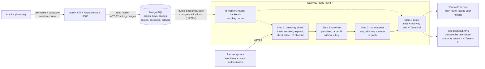
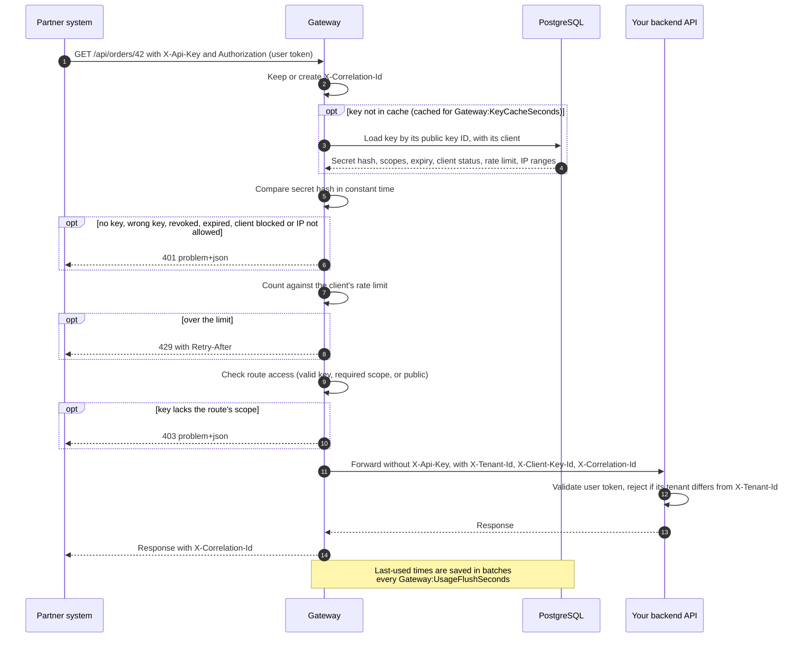
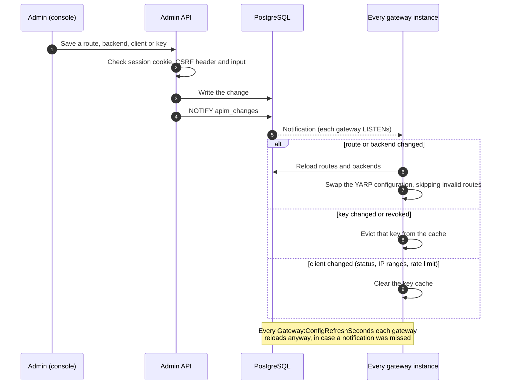

# Enterprise APIM

A B2B API gateway on .NET 10 and YARP. It decides **which partner systems (clients)** may call your APIs, and routes their requests to your backend services. **User** authentication stays in your own auth service: the gateway forwards the user's `Authorization` header untouched.



See [Architecture](#architecture) for how a request flows through the gateway and how changes reach it.

## What's in the box

| Path | What it is |
|---|---|
| `src/EnterpriseApim.Gateway` | YARP gateway. Routes and backends load from PostgreSQL; client keys checked on every request. |
| `src/EnterpriseApim.AdminApi` | REST API for clients, keys, routes and backends. Also serves the console. |
| `src/EnterpriseApim.AdminConsole` | React + TypeScript (Vite) admin console. |
| `src/EnterpriseApim.Core` | Shared EF Core model, key format, change notifications. |
| `samples/EnterpriseApim.SampleBackend` | Echo service for trying things out, plus a tenant-consistency middleware to copy into real backends. |

## Architecture

Two services share one PostgreSQL database. The **admin API** is the only writer of configuration: admins change clients, keys, scopes, routes and backends through the console, and it notifies the gateways. The **gateway** only reads: it serves partner traffic from an in-memory copy of the routes and a short-lived cache of keys. You can run several gateway instances behind a load balancer; each one listens for changes on its own.

### A partner request



### A change in the admin console



## Quick start (Docker)

```bash
cp .env.example .env          # change the values for anything beyond your laptop
docker compose up --build     # .env sets COMPOSE_PROFILES=postgres
```

PostgreSQL runs under the `postgres` [Compose profile](https://docs.docker.com/compose/how-tos/profiles/). `.env.example` turns it on with `COMPOSE_PROFILES=postgres`; without that line, pass `--profile postgres`. To use your own database, leave the profile off and set `APIM_DB_CONNECTION` in `.env` to its connection string.

1. Create your admin console account. You're asked for a password (at least 12 characters, not containing the username). See [Seeding data](#seeding-data) for scripting and recovery.
   ```bash
   docker compose exec admin dotnet EnterpriseApim.AdminApi.dll create-admin admin
   ```
2. Open the admin console at http://localhost:5080 and sign in with that account.
3. Open **Contoso Ltd** (a demo client) and choose **Issue key**. Give it the scope `orders.read`. Copy the key; it's shown once.
4. Call the gateway:

```bash
curl http://localhost:8080/public/status                          # public, no key
curl http://localhost:8080/api/echo/hi                            # 401: no client key
curl http://localhost:8080/api/echo/hi -H "X-Api-Key: <your key>" # 200, echoes what the backend got
curl http://localhost:8080/api/orders/1 -H "X-Api-Key: <your key>" # 200 with orders.read, 403 without
```

`requests.http` has the same calls for VS Code, Rider and Visual Studio.

## Local development

Requires the .NET 10 SDK, Node.js 20+ and Docker (for PostgreSQL).

```bash
docker compose up -d postgres                               # naming the service enables its profile

dotnet run --project samples/EnterpriseApim.SampleBackend   # :5100
dotnet run --project src/EnterpriseApim.AdminApi            # :5080, applies migrations and demo data
dotnet run --project src/EnterpriseApim.Gateway             # :8080

cd src/EnterpriseApim.AdminConsole
npm install
npm run dev                                                 # :5173, proxies /api to :5080
```

Development settings live in each project's `appsettings.Development.json`. Create your admin console account once per database (see [Seeding data](#seeding-data)):

```bash
dotnet run --project src/EnterpriseApim.AdminApi -- create-admin admin
```

### Database migrations

The schema is managed with [EF Core migrations](https://learn.microsoft.com/ef/core/managing-schemas/migrations/). They live in `src/EnterpriseApim.Core/Migrations`, next to `ApimDbContext`. The `dotnet-ef` tool is pinned in `dotnet-tools.json`; install it once per clone:

```bash
dotnet tool restore
```

Every `dotnet ef` command needs the same two options: `--project` is where the migrations live, and `--startup-project` is the app whose configuration (connection string) the tool uses. The examples below keep them in a variable (bash; in PowerShell, type them out):

```bash
EF="--project src/EnterpriseApim.Core --startup-project src/EnterpriseApim.AdminApi"
```

#### Create a migration

1. Change the model: an entity in `Entities.cs`, or its mapping in `ApimDbContext.OnModelCreating`.
2. Add a migration with a name that says what changed:
   ```bash
   dotnet ef migrations add AddTenantContactEmail $EF
   ```
   This creates `<timestamp>_AddTenantContactEmail.cs` (the `Up` and `Down` steps) and its `.Designer.cs` file, and updates `ApimDbContextModelSnapshot.cs`. Commit all three.
3. Review the generated `Up` method before committing. Look for:
   - **Renames:** EF can't tell a rename from a drop plus an add, so it may drop a column and its data. Replace the pair with `migrationBuilder.RenameColumn(...)`.
   - **New required columns** on tables that already have rows: give them a `defaultValue`, or add them as nullable, backfill, then make them required in a later migration.
   - **Data changes:** add `migrationBuilder.Sql("UPDATE ...")` where existing rows need converting.
4. To see the SQL it will run:
   ```bash
   dotnet ef migrations script <PreviousMigration> AddTenantContactEmail $EF
   ```

#### Apply migrations

- **Automatically (default):** the admin API applies pending migrations when it starts, so `dotnet run` or `docker compose up --build` is enough. The gateway never changes the schema.
- **By hand**, against the database in `appsettings.Development.json`, or another one with `--connection`:
  ```bash
  dotnet ef database update $EF
  dotnet ef database update $EF --connection "Host=db.example.com;Database=apim;Username=apim;Password=..."
  ```
- **From a deployment pipeline**, without the .NET SDK where it runs. Either generate an idempotent SQL script, which skips migrations that are already applied:
  ```bash
  dotnet ef migrations script --idempotent --output migrate.sql $EF
  psql "$DATABASE_URL" -f migrate.sql
  ```
  or build a self-contained migration bundle:
  ```bash
  dotnet ef migrations bundle --self-contained -r linux-x64 --output efbundle $EF
  ./efbundle --connection "Host=...;Database=apim;Username=...;Password=..."
  ```

#### Inspect, undo and roll back

```bash
dotnet ef migrations list $EF                         # all migrations; unapplied ones are marked (Pending)
dotnet ef migrations remove $EF                       # delete the last migration, if it isn't applied anywhere yet
dotnet ef database update <EarlierMigration> $EF      # roll the database back (runs the Down steps)
dotnet ef migrations has-pending-model-changes $EF    # fails if the model changed without a migration; use in CI
```

#### Rules of thumb

- Never edit or delete a migration that has been applied to a shared database; add a new one instead.
- If two branches both add migrations, merge, then remove yours and add it again so the snapshot is correct.
- The admin API refuses to start when the model has changes without a migration, so you notice before deploying.
- A database created before migrations were introduced (by `EnsureCreated`) is detected on startup, and `InitialCreate` is recorded as already applied.

## Seeding data

A new database needs two things before you can use it: an **admin user** to sign in to the console, which you always create yourself, and optionally **demo data** to try the gateway with.

### Seed the first admin user

The admin API never creates admin users by itself. While there are none, it starts normally and logs a reminder, but nobody can sign in. Create the first one with the `create-admin` command. It runs the admin API's own code with its own configuration (connection string), applies pending migrations first, creates the user, and exits.

| Where the admin API runs | Command |
|---|---|
| Docker Compose | `docker compose exec admin dotnet EnterpriseApim.AdminApi.dll create-admin <username>` |
| Local `dotnet run` | `dotnet run --project src/EnterpriseApim.AdminApi -- create-admin <username>` |
| Published app or any other container | `dotnet EnterpriseApim.AdminApi.dll create-admin <username>` (from the app's folder) |

For example, with Docker Compose:

```bash
docker compose exec admin dotnet EnterpriseApim.AdminApi.dll create-admin admin
```

```text
Password for admin: ************
Repeat the password: ************
Created admin user "admin". Sign in to the admin console with it.
```

- **Username:** 3 to 100 letters, digits, dots, dashes, underscores or `@`. Usernames aren't case-sensitive, so an email address works too.
- **Password:** at least 12 characters, not containing the username. It's typed at a hidden prompt and never passed as an argument, so it doesn't end up in configuration, the process list or shell history.
- The account is ready straight away; there's no forced password change. People you add later under **Admin users** in the console get a temporary password instead, which they replace at first sign-in.
- Running the command for a username that already exists changes nothing and tells you to use `--reset`.

#### Script it (CI, provisioning, Kubernetes jobs)

When standard input is redirected, the command reads the password from its first line instead of prompting. With `docker compose exec`, add `-T` so no terminal is allocated:

```bash
printf '%s\n' "$APIM_ADMIN_PASSWORD" | docker compose exec -T admin dotnet EnterpriseApim.AdminApi.dll create-admin admin
```

```powershell
$env:APIM_ADMIN_PASSWORD | docker compose exec -T admin dotnet EnterpriseApim.AdminApi.dll create-admin admin
```

To seed a database the admin API isn't running against yet, point the command at it with the connection string setting:

```bash
ConnectionStrings__Apim="Host=db.example.com;Database=apim;Username=apim;Password=..." \
  dotnet EnterpriseApim.AdminApi.dll create-admin admin
```

Exit codes: `0` done, `1` nothing changed (the user exists, the password breaks a rule, or the passwords didn't match), `2` wrong arguments.

#### Recover access (`--reset`)

If every admin is locked out, disabled, or has forgotten their password, reset one from the command line:

```bash
docker compose exec admin dotnet EnterpriseApim.AdminApi.dll create-admin admin --reset
```

It sets the new password you type, unlocks and enables the account, and signs it out everywhere. It only works for a username that exists; leave out `--reset` to create one.

### Seed demo data

With `Apim:SeedDemo` set to `true`, the admin API adds sample data at startup if the database has no backends yet. Docker Compose and `appsettings.Development.json` turn it on; it's off by default everywhere else. It creates:

| What | Details |
|---|---|
| Backend `sample-backend` | One server at `Apim:DemoBackendUrl` (the sample backend), health-checked on `/health` |
| Scope `orders.read` | Used by the `orders` route |
| Route `echo` | `/api/echo/{**catch-all}`, any client with a valid key |
| Route `orders` | `/api/orders/{**catch-all}`, only keys with `orders.read` |
| Route `public-status` | `/public/status`, public, no key needed |
| Client **Contoso Ltd** | 600 requests a minute, no keys yet (only if there are no clients) |

It never creates admin users or client keys, and it runs only once: as soon as any backend exists, it's skipped. Turn it off for real environments by leaving `Apim__SeedDemo` unset or setting it to `false`, for example by removing it from the `admin` service in `docker-compose.yml`.

## How it works

### Admin sign-in
The console uses username and password sign-in with a session cookie, so there's no token for the browser to store or leak.

- **First admin:** created from the command line with `create-admin`, never automatically. If everyone is locked out, the same command with `--reset` restores access. See [Seed the first admin user](#seed-the-first-admin-user).
- **More admins:** add them under **Admin users** with a temporary password, which they replace at first sign-in. Every admin can add, disable, unlock, reset and delete other admins. Nobody can disable or delete themselves, so one active admin always remains.
- **Passwords** are at least 12 characters, can't contain the username, and are stored as salted PBKDF2 hashes (ASP.NET Core Identity's `PasswordHasher`).
- **Sessions** end on sign-out, after `Admin:SessionIdleMinutes` without activity, or `Admin:SessionMaxHours` after sign-in. They also end immediately when the user's password is changed or reset, or the user is disabled or deleted.
- **Password guessing is slowed:** an account locks for `Admin:LockoutMinutes` after `Admin:MaxFailedSignIns` failures in a row, and each IP address gets 10 sign-in attempts per minute.
- **The cookie** is `HttpOnly`, `SameSite=Strict` and, outside Development, `Secure`. Browsers accept `Secure` cookies on `http://localhost`; anywhere else, serve the console over HTTPS. Requests that change data must also send an `X-Requested-With` header, which blocks cross-site request forgery.
- **Cookie encryption keys** are stored in PostgreSQL (`data_protection_keys`), so sessions survive restarts and work across several admin API instances.

### Client keys
- Format: `apim_<16-hex key ID>_<43-char secret>`. The key ID is public and safe to log. Only a SHA-256 hash of the secret is stored, so the full key is shown once, at creation.
- Clients send the key in `X-Api-Key`. The gateway caches lookups briefly (`Gateway:KeyCacheSeconds`) and compares hashes in constant time.
- Each client can hold several keys, so rotation needs no downtime: issue a new key, let the client switch, revoke the old one.
- A key's name, scopes and expiry date can be edited at any time; the client keeps using the same key, and every gateway picks up the change within seconds. Setting a later expiry date on an expired key makes it work again. Revoked keys can't be edited.
- Keys can carry **scopes**. A route that requires a scope only accepts keys with it; the scope `*` grants all scopes.

### Scopes
Scopes such as `orders.read` are kept in a catalog in the `scopes` table and managed on the console's **Scopes** page. Routes and keys choose from that list, so a typo can't create a scope that no key or route matches.

- A scope's name can't be changed, because partners' keys carry it. To rename one, add the new scope, move routes and keys to it, then delete the old one.
- A scope can only be deleted when no route requires it and no active key carries it. A database foreign key also stops routes from referencing a scope that doesn't exist.
- `*` (all scopes) isn't in the catalog. Choose **All scopes** when issuing a key; it includes scopes added later.

### Route access
Every route requires a valid client key by default (an ASP.NET Core fallback policy), including routes you add later. In the console each route is one of: any client with a valid key; only keys with a given scope; or public (no key, rate limited per IP).

### What backends receive
The gateway removes `X-Api-Key` and any client-supplied `X-Tenant-Id`, then adds:

| Header | Value |
|---|---|
| `X-Tenant-Id` | The client's ID, from the validated key |
| `X-Client-Key-Id` | Which key was used |
| `X-Correlation-Id` | The caller's value, or a new one (also returned to the caller) |
| `Authorization` | The user's token, unchanged |

### Linking users to clients (important)
The gateway proves *which client* is calling; your auth service proves *which user*. Your backends must check that they belong together, or a user of client A could act through client B's integration:

1. Route your login endpoint through the gateway, so only registered clients can log users in and the auth service receives `X-Tenant-Id`.
2. At login, only issue a token if the user belongs to that tenant, and put the tenant ID in the token as a `tenant_id` claim.
3. In every backend, reject requests where the token's `tenant_id` differs from `X-Tenant-Id`. `samples/EnterpriseApim.SampleBackend/TenantConsistencyMiddleware.cs` does this.

Backends must only accept traffic from the gateway (private network, firewall rules or mTLS). Otherwise a caller could skip the gateway and set `X-Tenant-Id` themselves.

### Changes apply in seconds
The admin API sends a PostgreSQL `NOTIFY` after every change. Each gateway instance `LISTEN`s and reloads routes, or evicts a revoked key from its cache, immediately. A periodic reload (`Gateway:ConfigRefreshSeconds`) covers missed notifications. Invalid routes are skipped and logged without blocking other changes.

### Rate limits
Per client (all of its keys together), set in the console. Requests without a valid key are limited per IP (`Gateway:AnonymousRateLimitPerMinute`). Over-limit requests get `429` with `Retry-After`.

## Configuration

| Setting | Project | Default | Notes |
|---|---|---|---|
| `ConnectionStrings:Apim` | Gateway, Admin | none | PostgreSQL connection string |
| `Admin:SessionIdleMinutes` | Admin | `60` | Sign out after this long without activity |
| `Admin:SessionMaxHours` | Admin | `12` | Sign out this long after sign-in, however active |
| `Admin:MaxFailedSignIns` | Admin | `5` | Failed sign-ins in a row before the account locks |
| `Admin:LockoutMinutes` | Admin | `15` | How long a locked account stays locked |
| `Apim:SeedDemo` | Admin | `false` | Adds demo data on a database with no backends; see [Seed demo data](#seed-demo-data) |
| `Apim:DemoBackendUrl` | Admin | `http://localhost:5100/` | Server address of the demo backend |
| `Gateway:ConfigRefreshSeconds` | Gateway | `60` | Safety-net reload interval |
| `Gateway:KeyCacheSeconds` | Gateway | `120` | Key lookup cache lifetime |
| `Gateway:AnonymousRateLimitPerMinute` | Gateway | `120` | Per-IP limit without a valid key |
| `Gateway:UsageFlushSeconds` | Gateway | `60` | How often "last used" times are saved |
| `Gateway:KnownProxies` | Gateway | `[]` | IPs of load balancers whose `X-Forwarded-For` is trusted |

Environment variables use double underscores, for example `Gateway__KnownProxies__0=10.0.0.5`.

## Before production

- **Run migrations as a deploy step** if you'd rather not let the admin API change the schema on startup; see [Apply migrations](#apply-migrations).
- **Serve the console over HTTPS** and keep the admin API on an internal network. For multi-factor sign-in and central offboarding, put it behind your identity provider (OpenID Connect with Entra ID, Keycloak or Okta).
- **Protect the cookie encryption keys at rest.** They're stored unencrypted in `data_protection_keys`. Add `ProtectKeysWithCertificate`, or a key vault such as `ProtectKeysWithAzureKeyVault`, to the `AddDataProtection()` call in the admin API's `Program.cs`.
- **Terminate TLS** in front of the gateway, and set `Gateway:KnownProxies` so IP allowlists and per-IP limits see real client addresses.
- **Isolate backends** so only the gateway can reach them.
- **PgBouncer:** `LISTEN` needs a session-level connection. If you use PgBouncer in transaction mode, point the gateway at PostgreSQL directly, or rely on the periodic refresh alone.
- **Secrets:** put the connection string in a secret store, not in `appsettings` files.
